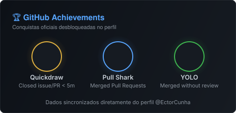
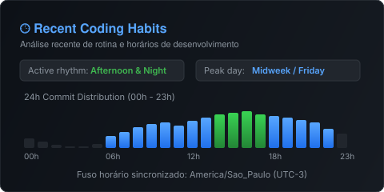
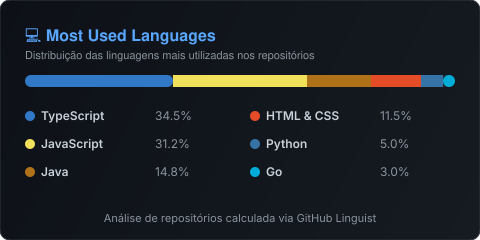
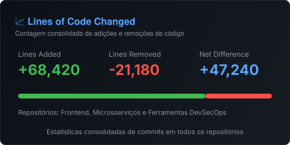

  <!-- Header Banner: Gradient Wave (Slateorange to Cyber Cyan) -->
  

  <!-- Animated Typing Headline -->
  

   

  <!-- Interactive Social & Profile Pill Bar (Without Instagram) -->
  

    
    
    
    
  

---

### 👨‍💻 About Me & Academic Background 👀 🎖️

<table>
  <tr>
    <td width="70%" valign="top">

🎓 **Bachelor’s Degree:** Systems Analysis and Development at [Estácio](https://estacio.br/).  
🎓 **Postgraduate Degree:** Networks and Cybersecurity at [Hackone](https://hackone.com.br/).  
🎓 **Technical Immersion:** Certified Tech Developer at [Digital House](https://www.digitalhouse.com/br/produtos/programacao/certified-tech-developer).  
🛡️ **Specialization & Residency:** DevSecOps through [Hackers do Bem](https://hackersdobem.org.br/).  

💡 **Core Focus:** Building high-performance software with native security integration throughout the CI/CD pipeline (SAST, DAST, SCA, Cloud Hardening & DevSecOps practices).

🔗 **Connect with me:** [LinkedIn Profile](https://www.linkedin.com/in/ector-cunha/)
    </td>
    <td width="30%" align="center" valign="middle">
        
      <strong>Passionate about technology, education, sports, and e-sports.</strong>
    </td>
  </tr>
</table>

---

## ⚡ GitHub Activity & Streaks

  

---

## 📈 GitHub Metrics & Analytics Suite

<!-- 3D Isometric Commit Calendar (Full-Year View) -->
### 📅 3D Isometric Commit Calendar (Full-Year)

  

 

<!-- Side-by-side: Achievements & Coding Habits -->

  <table>
    <tr>
      <th width="50%">🏆 GitHub Achievements & Badges</th>
      <th width="50%">🕒 Coding Habits & Productive Rhythm</th>
    </tr>
    <tr>
      <td align="center">
        
      </td>
      <td align="center">
        
      </td>
    </tr>
  </table>

 

<!-- Side-by-side: Most Used Languages & Lines of Code -->

  <table>
    <tr>
      <th width="50%">💻 Most Used Languages Breakdown</th>
      <th width="50%">📈 Lines of Code Changed</th>
    </tr>
    <tr>
      <td align="center">
        
      </td>
      <td align="center">
        
      </td>
    </tr>
  </table>

 

<!-- Profile Overview Card -->

  

---

## 🤖 Tech Stack & Tooling Ecosystem

### 🌐 Frontend Development

  
  
  
  
  
  
  
  
  
  
  
  

### ⚙️ Backend & Architecture

  
  
  
  
  

### 🗄️ Database & Storage

  
  
  

### 🛡️ Security & DevSecOps Pipeline

  
  
  
  
  
  
  
  

### 🧪 Testing & Code Quality

  
  

### 🛠️ IDEs, Tools & Productivity

  
  
  
  
  
  
  
  
  
  
  
  
  
  
  

### 🌐 Browsers & Testing Environments

  
  
  
  
  

### 📚 Continuous Learning & Education

  
  
  

---

## 🕹️ Gaming & Community

  
  

---

## 🐍 Contribution Graph Activity

  

<!-- Footer Banner: Gradient Wave (Cyber Cyan to Slateorange) -->

  

